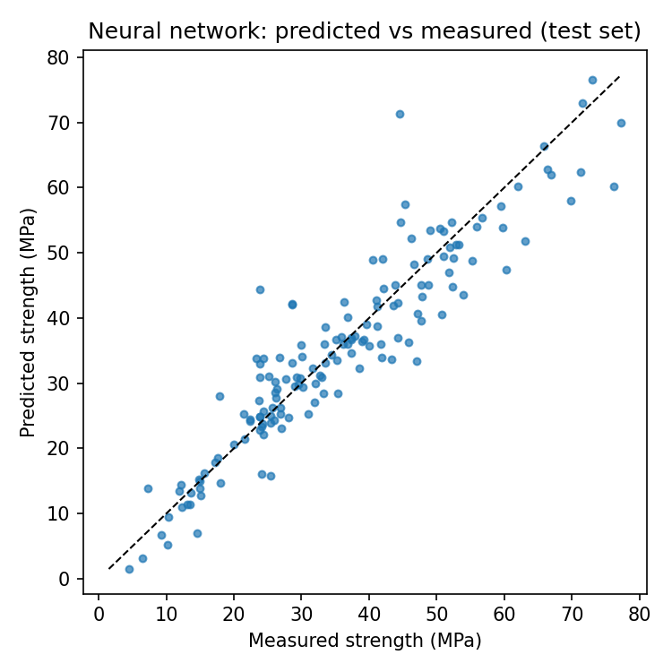
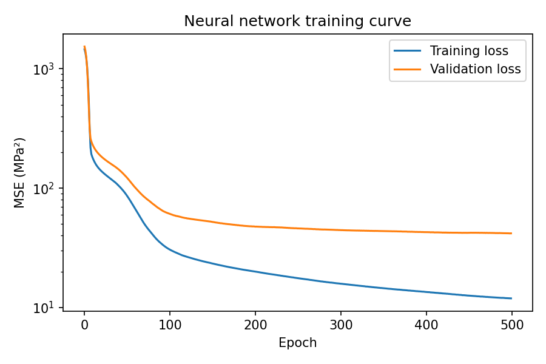

# Concrete Strength Prediction using Neural Networks

Predicts the compressive strength of concrete (in MPa) from its mix proportions and age, using a neural network built with Keras. Two scikit-learn models are included as baselines so the result has something to be compared against.

## Dataset
The [UCI Concrete Compressive Strength](https://archive.ics.uci.edu/dataset/165/concrete+compressive+strength) data (Yeh, 1998): 1,030 lab samples with 8 inputs (cement, blast furnace slag, fly ash, water, superplasticizer, coarse aggregate, fine aggregate, age in days) and the measured strength as the target. There are no missing values, but 25 rows are exact duplicates. They are dropped before splitting so identical samples can't appear in both train and test, leaving 1,005 rows.

## Method
- Split: 70% train (703), 15% validation (151), 15% test (151), fixed random seed
- Features standardised with a scaler fitted on the training set only
- Neural network: `Dense(64, relu)` → `Dense(32, relu)` → `Dense(1)`, Adam optimiser, MSE loss, early stopping on validation loss (it ran to the 500-epoch cap)
- Baselines: linear regression and a 300-tree random forest on the same split

## Results (held-out test set, 151 samples)
| Model | MAE (MPa) | RMSE (MPa) | R² |
|---|---|---|---|
| Linear regression | 8.95 | 11.12 | 0.51 |
| Neural network (Keras) | 4.18 | 5.93 | 0.86 |
| Random forest | 3.69 | 5.02 | 0.90 |

The neural network explains far more variance than a linear model, which fits the fact that strength depends non-linearly on mix and age. On this split the random forest edged it out, which is common for small tabular datasets. Results come from a single split and seed, so differences of this size should not be over-read. Cross-validation would be the next step.




## Run it
```bash
pip install -r requirements.txt
python train.py
```
Metrics are written to `results/metrics.json` and the plots to `results/`.

## Files
- `train.py`: data loading, split, models, evaluation and plots
- `data/concrete_compressive_strength.csv`: the dataset
- `results/`: saved metrics and figures

## Credit
I-Cheng Yeh, "Modeling of strength of high performance concrete using artificial neural networks", *Cement and Concrete Research*, 28(12), 1998. Dataset from the UCI Machine Learning Repository (CC BY 4.0).
